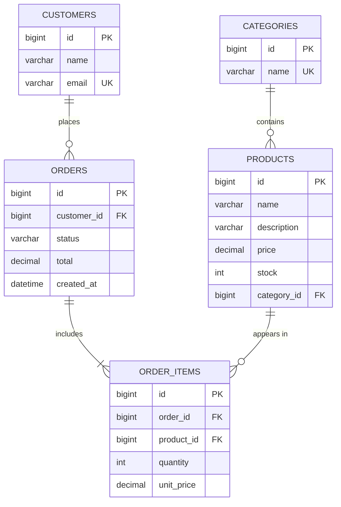

# E-commerce Backend (Spring Boot)

A multi-tier e-commerce backend with a REST API, relational database, order and stock management, interactive API documentation, and a small demo storefront served by the same application.

- **Live website:** _add your deployed URL here_
- **API documentation (Swagger UI):** `<your-url>/swagger-ui.html`
- **Demo video:** _add your link here_

## Features
- Product catalogue with categories, search and category filter
- Customer registration
- Order placement with stock checking and automatic stock reduction
- Order lifecycle: `PLACED -> PAID -> SHIPPED -> DELIVERED`, cancellable before shipping (stock is restored)
- Price captured at purchase time, so later price changes do not alter old orders
- Bean Validation with clear field-level errors and a global exception handler
- Interactive API docs (springdoc OpenAPI) and a demo web storefront
- Sample data loaded on first start

## Tech stack
Java 17, Spring Boot 3, Spring Web (REST), Spring Data JPA / Hibernate, Bean Validation, springdoc-openapi, H2 (default), MySQL or PostgreSQL (optional), Maven, Docker.

## Architecture

```
Browser / Postman
        |
Controller layer      REST endpoints, JSON in/out, input validation (@Valid)
        |
Service layer         business rules, transactions (stock, status changes)
        |
Repository layer      Spring Data JPA interfaces
        |
Database              H2 / MySQL / PostgreSQL
```

| Package | Responsibility |
|---|---|
| `controller` | HTTP endpoints for categories, products, customers, orders |
| `service` | Business logic and `@Transactional` boundaries |
| `repository` | Database access, including a row-locking query for stock |
| `model` | JPA entities and the `OrderStatus` lifecycle |
| `dto` | Request and response objects, so entities are never exposed directly |
| `exception` | Custom exceptions and the `@RestControllerAdvice` handler |
| `config` | OpenAPI setup and sample-data seeder |

## Database design



Tables are created automatically by Hibernate (`spring.jpa.hibernate.ddl-auto=update`).

## API endpoints

| Method | URL | Description |
|---|---|---|
| GET | `/api/categories` | List categories |
| POST | `/api/categories` | Create a category |
| DELETE | `/api/categories/{id}` | Delete an empty category |
| GET | `/api/products?categoryId=&search=` | List or filter products |
| GET | `/api/products/{id}` | Get a product |
| POST | `/api/products` | Create a product |
| PUT | `/api/products/{id}` | Update a product |
| DELETE | `/api/products/{id}` | Delete a product |
| POST | `/api/customers` | Register a customer |
| GET | `/api/customers/{id}` | Get a customer |
| GET | `/api/customers/by-email?email=` | Find a customer by email |
| POST | `/api/orders` | Place an order |
| GET | `/api/orders/{id}` | Get an order |
| GET | `/api/orders/customer/{customerId}` | List a customer's orders |
| PATCH | `/api/orders/{id}/status` | Move an order to the next status |

Example order request:
```json
{
  "customerId": 1,
  "items": [
    { "productId": 1, "quantity": 2 },
    { "productId": 4, "quantity": 1 }
  ]
}
```

Error responses are consistent:

| Situation | Status |
|---|---|
| Invalid input, malformed JSON | 400 (with `fieldErrors` for validation) |
| Product, customer or order not found | 404 |
| Duplicate email or category, not enough stock, illegal status change | 409 |

## Build and run locally

Requirements: JDK 17+ and Maven.

```bash
mvn spring-boot:run
```

Open `http://localhost:8080` for the storefront and `http://localhost:8080/swagger-ui.html` for the API docs. Run tests with `mvn test`.

### Use MySQL or PostgreSQL
Set environment variables before starting (no passwords in the repo):
```bash
export SPRING_DATASOURCE_URL=jdbc:mysql://localhost:3306/shopdb
export SPRING_DATASOURCE_USERNAME=root
export SPRING_DATASOURCE_PASSWORD=your_password
```
For PostgreSQL use a URL like `jdbc:postgresql://host:5432/shopdb`.

### Docker
```bash
docker build -t shop-backend .
docker run -p 8080:8080 shop-backend
```

## Deploy (live website)
The app is a Docker-ready web service, so it can be hosted on any platform that runs Docker containers (for example Render or Railway):
1. Push this repo to GitHub.
2. Create a new Web Service from the repo and choose the Docker runtime.
3. The app reads the `PORT` variable automatically.
4. With the default H2 database, data resets whenever the service restarts. For permanent data, add a hosted database and set the three `SPRING_DATASOURCE_*` variables.
5. Put the final URL at the top of this README.

## Demo video checklist
1. Show the project structure and explain the layers.
2. Open the live site: browse, search, add to cart, place an order.
3. Open Swagger UI and call a few endpoints (create product, get order).
4. Show a validation error (400) and an out-of-stock error (409).
5. Show the order status flow and that cancelling restores stock.
6. Show the database tables or the ER diagram above.

## Possible improvements
Authentication with JWT, payments, pagination, product images, and an admin role.
